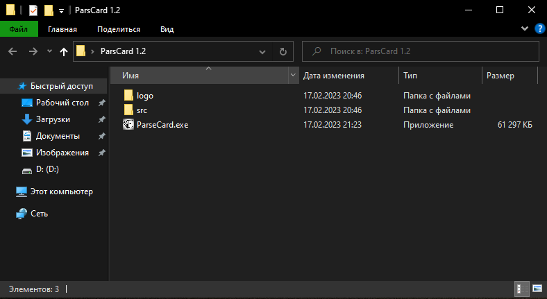
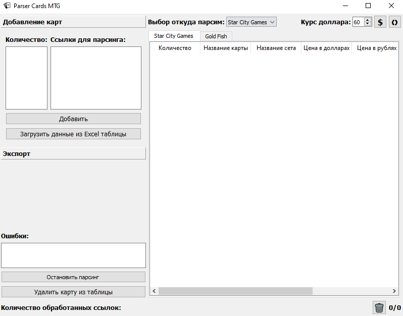
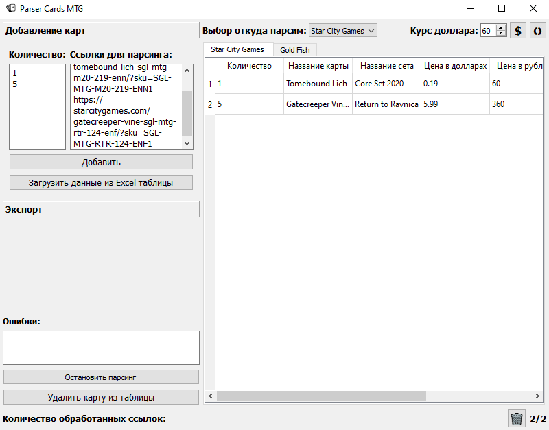

# QtParserMTG 1.2

## О проекте

### Описание

Приложение предназначено для хранения информации о картах (количество, название карты, название сете, цена в долларах, цена в рублях, ссылка).
Цель приложения сбор информации для продажи карт, мониторинг цен, создание выходной Excel таблицы.

### Технологии

- Python
- PyQt5
- SQLite
- BeautifulSoup
- Pandas
- pytest

## Запуск приложения

Запустите exe файл приложения находящийся в папке ParsCard.

Главное окно после запуска программы.

После добавление количества карт и ссылок в Text Edit их можно будет добавить в таблицу.

### Описание кнопок
- $ - Перерасчёт цены в рублях;
- 🗘 - Обновление цен карт;
- 🗑 - Удаление всех карт из таблиц;

## Будущие изменения

- [x] Добавление multiprocessing, для ускорения парсинга;
- [x] Сделать сборку приложения под Linux;
- [x] Добавить поис по названию и фильтры;
- [x] Переделать взаимодействие с БД;
- [ ] Сделать сборку приложения под Win7;
- [ ] Собрать инсталлятор с помощью NSIS;
- [ ] Добавить обновление цены одной карты;
- [ ] Написать свои исключения (для обработки ошибок парсинга);
- [ ] Перенести config файлы и cards.db в отдельную папку resources;
- [ ] Добавить пользователей чтобы у каждого была своя коллекция карт.

## Ссылки для скачивания образа:
- Win10: https://drive.google.com/file/d/1GEc-WH_wX4OJJ1GYCzBXzdF0nJy6M6fi/view?usp=sharing;
- linux: https://drive.google.com/file/d/13PMqJ5mlYHNnoeXo1IBbpFr22s18raqS/view?usp=sharing.
